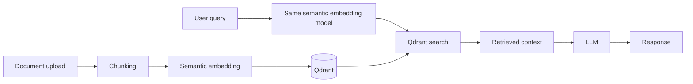

# Semantic embeddings operations

The existing FastAPI API now defaults to `SentenceTransformerEmbeddingProvider`, with
`sentence-transformers/all-MiniLM-L6-v2`, 384 normalized values, CPU inference, and Qdrant
cosine similarity. The LLM may remain mocked independently; no paid inference service is
needed for ingestion or retrieval. The existing endpoint response schemas are preserved.



## Configuration and lifecycle

| Variable | Default |
| --- | --- |
| `EMBEDDING_PROVIDER` | `sentence_transformers` (`mock` also supported) |
| `EMBEDDING_MODEL` | `sentence-transformers/all-MiniLM-L6-v2` |
| `EMBEDDING_MODEL_REVISION` | `c9745ed1d9f207416be6d2e6f8de32d1f16199bf` |
| `EMBEDDING_DIMENSIONS` | `384` (set explicitly to `8` for the SHA-256 baseline) |
| `EMBEDDING_DEVICE` | `cpu` (other devices are rejected) |
| `EMBEDDING_BATCH_SIZE` | `32` |
| `EMBEDDING_CACHE_DIR` | Library cache unless explicitly configured; `/models` in Docker/Kubernetes |
| `COLLECTION_NAME` | `documents-minilm-v1` |

The revision must be a complete immutable commit SHA. Named branches/tags are rejected.
The default model requires 384 dimensions; custom models must match their configured output
dimension at initialization. Unknown providers fail configuration validation. Import,
download, and model errors fail startup with actionable diagnostics; no mock fallback occurs.
Only safetensors weights are loaded and remote model code is disabled. The provider resolves
the immutable Hub snapshot and requires `modules.json` before constructing the encoder,
preventing a silent generic-pooling fallback for incomplete model artifacts.

One provider is constructed during each application worker's lifespan and stored in
application state. Both documents and queries resolve that provider through the existing
FastAPI dependency injection point. Tests can override it explicitly. Ingestion uses optional
`embed_batch` and falls back to `embed` for older injected providers. All embeddings and
counts are validated before a single document write. Filenames, UUID document IDs, indexes,
text, and chunking are preserved. Empty documents produce zero chunks; blank semantic
embedding inputs raise a validation error. The mock retains its deterministic baseline behavior.

Startup initialization and upload processing run in worker threads. Search and ask remain
synchronous FastAPI handlers and therefore run in worker threads too. A per-model lock
serializes CPU encoding to avoid concurrent model contention. Set `OMP_NUM_THREADS` before
process start; deployment defaults to two CPU threads. Increasing workers duplicates model
memory. Large uploads still hold all chunks/vectors in memory; this phase does not introduce
streaming, transactions across many requests, or new formats.

`/health` remains liveness. `/ready` returns 503 until embedding and collection initialization
succeed, and after shutdown. Startup failure prevents the server from accepting traffic.
Readiness represents successful initialization, not continuous Qdrant availability monitoring.

## CPU installation and startup

The lock targets Python 3.12 on Linux x86_64. It pins transitive dependencies, including
`torch==2.5.1+cpu`; the PyTorch CPU index is required. No CUDA packages are installed.

```bash
cd services/rag-api
python3.12 -m venv .venv
.venv/bin/pip install -r requirements.lock
.venv/bin/pip install --no-deps --no-build-isolation -e .
cd ../..
docker compose up -d qdrant
export QDRANT_URL=http://localhost:6333 COLLECTION_NAME=documents-minilm-v1
export EMBEDDING_CACHE_DIR=/tmp/rag-models HF_HOME=/tmp/rag-hf OMP_NUM_THREADS=2
services/rag-api/.venv/bin/uvicorn app.main:app --app-dir services/rag-api
```

Or run `docker compose up --build`. The first startup downloads model artifacts from
Hugging Face, requiring TLS trust and permitted outbound access to Hugging Face and its
artifact/CDN hosts. Loading completes before readiness. Subsequent starts reuse cached
weights; the library may check remote metadata without downloading unchanged weights.
To prove a disconnected cached start, set `HF_HUB_OFFLINE=1 TRANSFORMERS_OFFLINE=1` **before
starting a new process**. Prepare the cache with the exact same model/revision and runtime.
Compose persists `/models` in `embedding-cache`. Do not use `docker compose down -v` when
preserving model or Qdrant data. Kubernetes mounts a 2Gi model-cache PVC and allows up to
15 minutes for startup; the model needs roughly 1Gi requested / 2Gi limited pod memory,
subject to profiling. Cache mounts must be writable by UID/GID 1000.

Kubernetes keeps its existing immutable image reference until this change is built and
published; update the image to that reviewed digest before deployment. The new PVC uses
the cluster's default storage class. Its ReadWriteOnce mode may constrain multi-node HPA
scaling or rolling updates. Use a suitable shared/prewarmed cache or per-pod cache strategy
before scaling across nodes; do not assume the current claim supports it.

## Safe Qdrant migration

Every managed collection has a companion `<collection>__embedding_manifest` collection
containing one identity record: provider, model, immutable revision, normalization,
dimensions, and distance. Keeping this outside the data collection prevents artificial
search hits and inflated document/chunk counts. Back up both collections together.

Every initialization verifies the data collection's unnamed-vector dimension and cosine
metric, then compares the complete identity manifest. Missing, conflicting, or orphaned
manifests fail closed, including legacy collections with no identity record. Initialization
is idempotent for a compatible pair and never deletes populated collections. Creation
across two Qdrant collections is not transactional; initialize a new pair before scaling
multiple workers. Concurrent creators or interrupted initialization may fail closed;
select another new name rather than guessing the identity of existing data.

To migrate existing mock data safely:

1. Preserve the legacy `documents` collection and retain original `.txt` sources. SHA-256
   vectors cannot be converted into semantic vectors.
2. Set `COLLECTION_NAME=documents-minilm-v1` (or a fresh versioned name), configure the real
   model, and start the API. It creates a separate 384-dimensional cosine collection.
3. Re-upload the original files through `/documents/upload`. The API does not retain source
   files itself, so restoring originals is an operator prerequisite. New ingestion assigns
   new document UUIDs as before.
4. Run the integration test and benchmark, inspect relevance failures, compare counts, and
   smoke-test `/search` and `/ask` before switching traffic.
5. Keep the old data and previous API image/config for rollback. Delete legacy collections
   only through a separately reviewed retention decision. Never edit a manifest to force
   mismatched vectors to pass validation.

Example re-ingestion from an operator-owned directory of retained sources (API running
against the new collection):

```bash
for source_file in ./retained-sources/*.txt; do
  curl --fail --show-error -F "file=@${source_file}" http://localhost:8000/documents/upload || break
done
curl --fail http://localhost:8000/documents
curl --fail -H 'Content-Type: application/json' \
  -d '{"query":"How can I keep a database off the public internet?","top_k":3}' \
  http://localhost:8000/search
```

Mock-only test or baseline environments must explicitly select both
`EMBEDDING_PROVIDER=mock EMBEDDING_DIMENSIONS=8` and a separate collection name.

## Validation and limitations

```bash
services/rag-api/.venv/bin/python -m pytest services/rag-api/tests -m 'not integration' -q
RUN_SEMANTIC_INTEGRATION=1 EMBEDDING_CACHE_DIR=/tmp/rag-models \
  services/rag-api/.venv/bin/python -m pytest services/rag-api/tests -m integration -v
services/rag-api/.venv/bin/python -m ruff check services/rag-api benchmarks/semantic-retrieval
```

Integration requires a real Qdrant HTTP server and the genuine pinned model. It exercises
upload, semantic paraphrase retrieval, ask with mock LLM, API restart persistence, offline
cached model load in a new process, and safe mock/semantic separation. It leaves isolated
UUID collections for inspection. CI includes a real Qdrant service, persistent model cache,
and a benchmark artifact; it does not substitute a fake encoder for this job.

See [benchmark methodology and recorded results](../benchmarks/semantic-retrieval/README.md)
and [execution evidence](../evidence/semantic-embeddings.md). Phase 1 acceptance passed:
50 tests including genuine CPU/Qdrant integration, 384-dimensional real vectors, offline
API restart, Docker build/endpoints/restart, and the unchanged 30-question benchmark.
Semantic Recall@1 is 83.33%, Recall@3 96.67%, and MRR 0.902778; five top-1 misses remain.
Terraform and its existing provider-lockfile limitation remain outside this work.


Container smoke validation uses the existing Compose Qdrant network and leaves data in
fresh UUID-named collections. It removes only its own disposable API container:

```bash
services/rag-api/.venv/bin/python scripts/semantic-container-smoke.py \
  --image rag-api:semantic --output /tmp/semantic-smoke.json
# Separately verify mock plumbing without representing it as semantic evidence:
services/rag-api/.venv/bin/python scripts/semantic-container-smoke.py \
  --image rag-api:semantic --mock --output /tmp/mock-smoke.json
```

Pass `--ca-bundle /path/to/combined-ca.pem` when your managed proxy requires its CA.
The script configures both cases of `no_proxy` for internal Qdrant traffic; model downloads
retain the configured proxy and TLS verification.


## Explicit provisioning for offline container validation

The validated host cache is a Hugging Face **hub cache**, containing `blobs/` and
`snapshots/` below `models--sentence-transformers--all-MiniLM-L6-v2`. Preserve relative
symlinks and verify the immutable revision and artifact hashes before provisioning.
The application image does not include these model weights. A host cache is not automatically
available in Docker, and the Compose `embedding-cache` volume is a separate store.

To reproduce the validated offline path with an existing verified cache:

```bash
python scripts/semantic-container-smoke.py --image rag-api:semantic \
  --offline --model-cache /workspace/.cache/phase1-embeddings/hub \
  --output /tmp/semantic-container-real.json
```

This explicitly mounts the entire hub cache read-only at `/models`, uses a separate writable
`HF_HOME`, and sets both offline flags before process startup. It tests a separate CPU encoder
container with `--network none` plus a network-attempt audit guard, then exercises the API on
the existing Compose Qdrant network and verifies persisted counts and retrieval after restart.
It removes only its disposable containers; collections and Qdrant data are preserved.
No external model download is attempted in this mode. Host cache permissions must allow
container UID/GID 1000 to traverse directories and read files.

For the normal Compose named-volume path, populate `embedding-cache` separately before
switching to offline startup. For example, with model-host access and the required proxy CA
configured for the runtime, prewarm using the same image and exact provider configuration:

```bash
docker compose run --rm --no-deps --entrypoint python rag-api -c \
  "from app.config import get_settings; from app.embeddings import create_embedding_provider; p=create_embedding_provider(get_settings()); assert len(p.embed('Kubernetes workload scheduling')) == 384"
```

Then set `HF_HUB_OFFLINE=1` and `TRANSFORMERS_OFFLINE=1` in the API container environment
for disconnected startup, retaining that same volume. Those flags must be passed to the
container; exporting them only in the host shell does not automatically pass them through
Compose. The named-volume online prewarm command is an operator alternative; this execution
validated the explicit read-only bind path described above.
